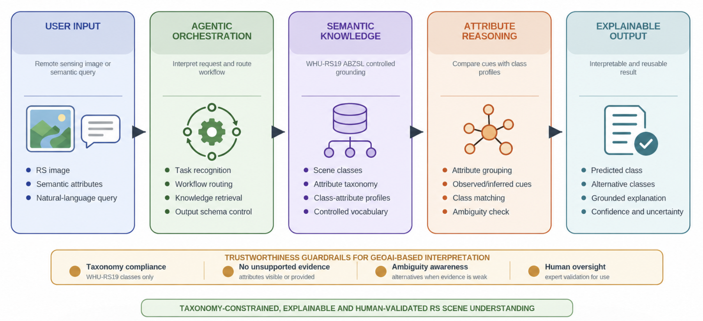

<h1 align="center">GeoRS-Agent</h1>

<h3 align="center">An Agentic GeoAI Framework for Attribute-Grounded and Explainable Remote Sensing Scene Understanding</h3>

<p align="center">
  
  <a href="https://doi.org/10.3390/rs17142384"></a>
  
  
</p>

<p align="center">
  Marina Paolanti<sup>1</sup>, Roberto Pierdicca<sup>2</sup><br>
  <sup>1</sup> Dept. of Political Sciences, Communication and International Relations, University of Macerata<br>
  <sup>2</sup> Dept. of Civil and Building Engineering and Architecture (DICEA), Università Politecnica delle Marche
</p>

---

## Overview

Most remote sensing (RS) scene-understanding systems return a class label with little indication of the semantic evidence behind it. **GeoRS-Agent** is an interaction and explanation layer that turns an aerial image or a set of semantic cues into a structured, attribute-grounded interpretation. It

- organises evidence into **objects, dominant colours and geometric patterns** from the WHU-RS19 ABZSL vocabulary;
- maps that evidence to plausible **WHU-RS19 scene classes**;
- reports **alternative classes** and an explicit **uncertainty note** instead of forcing a single label;
- returns a human- and machine-readable **structured output**.

The agent is a conversational LLM configured with instructions, reference knowledge and an output schema. It is not a trained image classifier, and class interpretation is performed by the instructed LLM, not by a separate scoring module.

<p align="center">
  
</p>
<p align="center"><sub><b>Figure 1.</b> User input, agentic orchestration, WHU-RS19 ABZSL semantic knowledge, attribute reasoning and explainable output, constrained by trustworthiness guardrails. Class interpretation is a logical function of the LLM, not a separate software module.</sub></p>

## What is in this repository

| | |
|---|---|
| `agent/` | Agent instructions, model/configuration record, output schemas |
| `knowledge_base/` | 19 WHU-RS19 classes, 38 WHU-RS19 ABZSL attributes, class–attribute profiles |
| `examples/controlled/` | The two controlled attribute queries (Cases A and B) |
| `evaluation/` | Per-image results (Table 3), label equivalences, protocol, slot for raw outputs |
| `src/georsagent/` | Python tools: outcome measures, response validator, profile builder |
| `tests/` | Tests, including reproduction of the reported values (8/10, 9/10, 3/10) |

Not included: WHU-RS19 images (download from the original source) and WHU-RS19 ABZSL annotations (gated; request from the dataset authors, see [Related resources](#related-resources)).

```
GeoRS-Agent/
├── agent/
│   ├── system_prompt.md
│   ├── model_config.yaml
│   ├── output_schema.json
│   └── output_schema.strict.json
├── knowledge_base/
│   ├── whu_rs19_classes.json
│   ├── abzsl_attributes.json
│   └── class_attribute_profiles.csv
├── examples/controlled/
│   ├── case_a_port.json
│   └── case_b_river_pond.json
├── evaluation/
│   ├── image_tests.csv
│   ├── label_equivalences.json
│   ├── image_test_instruction.md
│   └── raw_outputs/
├── src/georsagent/
├── tests/
└── docs/figures/
```

## Quick start

```bash
git clone <repository-url> GeoRS-Agent
cd GeoRS-Agent
python -m venv .venv && source .venv/bin/activate
pip install -r requirements.txt
pip install -e .

pytest                                              # 21 tests
georsagent metrics                                  # reproduce the image-based measures
georsagent validate examples/controlled/*.json      # audit structured responses
```

To use the agent itself, configure a conversational LLM with `agent/system_prompt.md`, attach the files in `knowledge_base/` as reference material and request the structured output mode. Record the platform, model and version in `agent/model_config.yaml`.

## Structured output

```json
{
  "scene_interpretation": {"predicted_class": "port", "confidence": "high"},
  "attribute_analysis": {
    "objects": ["water", "dock", "water vehicles"],
    "dominant_colours": ["blue", "gray"],
    "geometric_patterns": ["rectangle", "line"]
  },
  "alternative_classes": [
    {"class": "river", "reason": "Water is present, but docks and water vehicles make a natural river interpretation less likely."}
  ],
  "explanation": "The scene is interpreted as port because the combination of water, dock and water vehicles strongly supports a maritime infrastructure scene. ...",
  "uncertainty_note": "The interpretation is high-confidence given the provided attributes. Expert validation is recommended for operational use."
}
```

Confidence is an uncalibrated verbal judgement generated by the model. The prototype computes no numeric score, so the schema has no score field. Full example: [`examples/controlled/case_a_port.json`](examples/controlled/case_a_port.json).

## Results

### Controlled attribute queries

| Input attributes | Interpretation | Alternatives |
|---|---|---|
| water, dock, water vehicles, blue, gray, rectangle, line | **port** (high) | river, bridge, commercial |
| water, blue, curve, green | **river / pond** (moderate) | beach, park, meadow |

These inputs were selected from known class–attribute associations. They illustrate response structure and ambiguity handling, not recognition performance.

### Image-based assessment (one image per category, ground truth not disclosed)

| Reference class | Predicted label | Exact match | Observation |
|---|---|:-:|---|
| airport | airport | ✓ | Aircraft reported absent |
| beach | beach | ✓ | *island* alternative |
| bridge | bridge | ✓ | *overpass* alternative |
| commercial | commercial | ✓ | Canonical alternatives |
| farmland | farmland | ✓ | Canonical alternatives |
| forest | forest | ✓ | Canonical alternatives |
| industrial | industrial | ✓ | *parking lot* alternative |
| parking | *parking lot* | ✗ | Semantically equivalent label |
| railway station | railway station | ✓ | *overpass* alternative |
| viaduct | *overpass* | ✗ | Reference class discounted |

| Measure | Result |
|---|---|
| Exact-match accuracy (primary label) | **8/10** |
| Semantic class agreement (*parking lot* ≡ *parking*) | **9/10** |
| Full-response taxonomy compliance (primary + all alternatives canonical) | **3/10** |

A plausible primary class and compliance with a controlled taxonomy are different objectives: prompt-level constraints alone did not keep alternatives inside the 19-class vocabulary. Taxonomy compliance also differs from semantic correctness. *Overpass* describes a real structure but is not a WHU-RS19 label, and in the viaduct case the agent additionally rejected the true class. Details and limitations: [`evaluation/README.md`](evaluation/README.md).

## Audit tools

`georsagent validate` checks a structured response deterministically: schema structure, canonical primary and alternative labels, attributes outside the ABZSL vocabulary or in the wrong group, and numeric confidence values. It reports problems and never relabels. These checks correspond to the deterministic output validation listed as future work in the manuscript; they were **not** part of the prototype that produced the reported results. `agent/output_schema.strict.json` expresses the same taxonomy constraints as a JSON Schema for platforms that support schema-constrained generation.

`georsagent build-profiles` derives per-class attribute prevalence from the WHU-RS19 ABZSL annotations, with options to use the training split only or to exclude evaluation images. See [`knowledge_base/README.md`](knowledge_base/README.md).

## Limitations

- **Small, non-exhaustive evaluation:** ten images covering ten of nineteen classes, one image per class, no verified held-out sampling.
- **Prompt-only guardrails:** label constraints are instructions, not enforced rules, and were violated in 7 of 10 image responses.
- **Attribute grounding errors:** a correct class does not guarantee correct attribute extraction (airport case).
- **Uncalibrated confidence:** verbal confidence words are not probabilities.
- **No open-set handling:** there is no out-of-distribution detector and no tested abstention option for scenes that do not fit any WHU-RS19 class.
- **No baselines or expert rating:** no comparison with an unconstrained LLM; no independent multi-rater assessment of explanations.

Outputs are intended to support expert interpretation, not replace it.

## Related resources

- **WHU-RS19 ABZSL** — attribute-annotated extension of WHU-RS19 used as knowledge base. Balestra, Paolanti & Pierdicca, *Remote Sensing* 17(14), 2384, 2025. [doi:10.3390/rs17142384](https://doi.org/10.3390/rs17142384) · [repository](https://github.com/marinapaolanti/WHU-RS19-ABZSL-An-Attribute-Based-Dataset-for-Remote-Sensing-Image-Understanding)
- **RSplitZero** — generalized zero-shot learning across attribute splits on WHU-RS19 ABZSL. Stacchio, Nepi, Paolanti & Pierdicca, *International Journal of Digital Earth* 18(2), 2551869, 2025. [doi:10.1080/17538947.2025.2551869](https://doi.org/10.1080/17538947.2025.2551869)
- **WHU-RS19** — Xia et al., *Structural High-Resolution Satellite Image Indexing*, ISPRS TC VII Symposium, 2010.

## Citation

If you use this repository, please cite the paper and the knowledge-base dataset:

```bibtex
@article{paolanti2026georsagent,
  title   = {{GeoRS-Agent}: An Agentic {GeoAI} Framework for Attribute-Grounded and Explainable Remote Sensing Scene Understanding},
  author  = {Paolanti, Marina and Pierdicca, Roberto},
  journal = {Computers},
  year    = {2026},
  note    = {Under review}
}

@article{balestra2025whurs19abzsl,
  title   = {{WHU-RS19 ABZSL}: An Attribute-Based Dataset for Remote Sensing Image Understanding},
  author  = {Balestra, Mattia and Paolanti, Marina and Pierdicca, Roberto},
  journal = {Remote Sensing},
  volume  = {17},
  number  = {14},
  pages   = {2384},
  year    = {2025},
  doi     = {10.3390/rs17142384}
}
```

## License

Code (`src/`, `tests/`) is released under the [MIT License](LICENSE). Documentation, agent instructions, knowledge-base files, examples and figures are released under [CC BY 4.0](LICENSE-CONTENT.md). WHU-RS19 images and WHU-RS19 ABZSL annotations are not redistributed and remain subject to their own terms.

## Contact

Marina Paolanti — [marina.paolanti@unimc.it](mailto:marina.paolanti@unimc.it)
