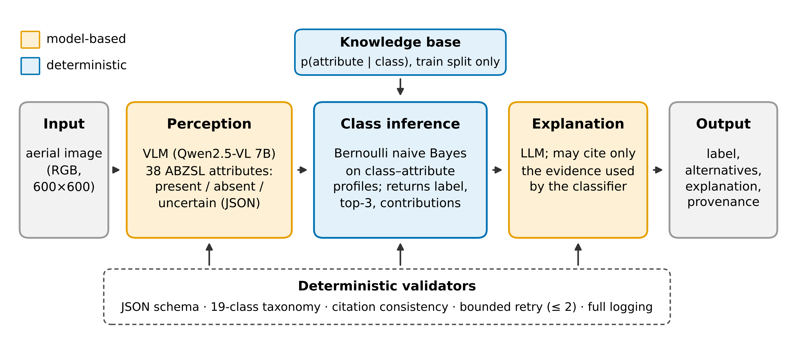
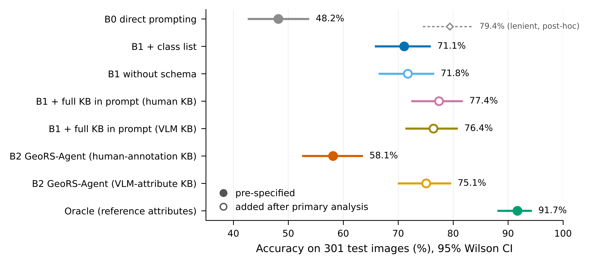
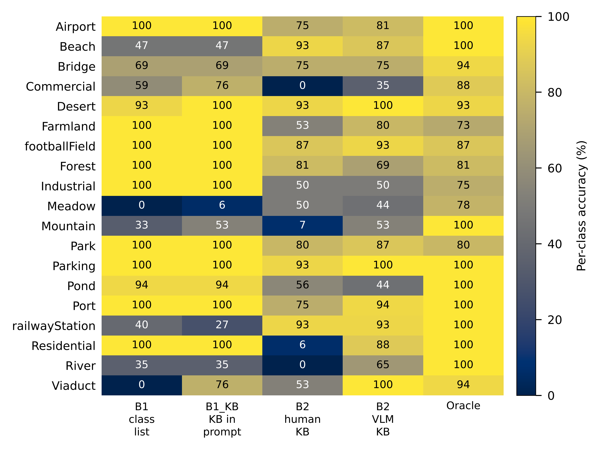
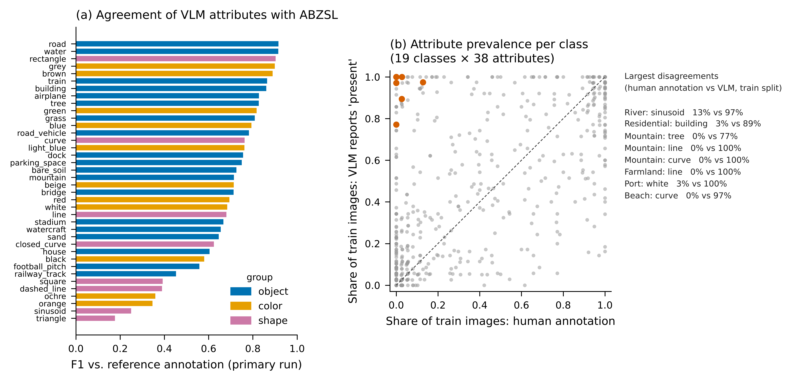
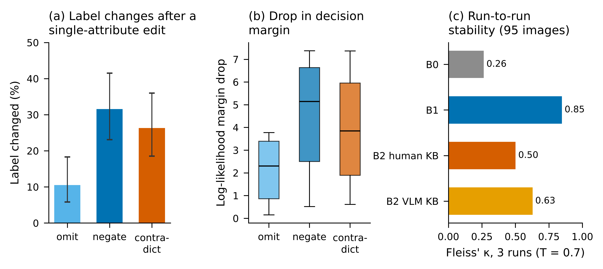
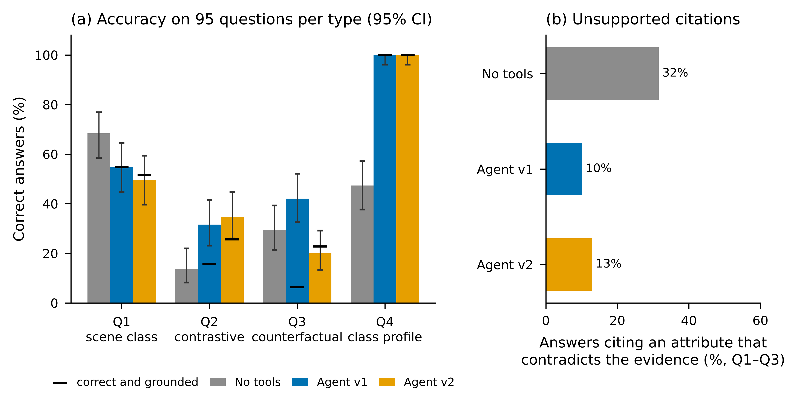

<p align="center">
  
</p>

<p align="center">
  <b>Marina Paolanti</b><sup>1</sup> &nbsp;·&nbsp; <b>Roberto Pierdicca</b><sup>2</sup><br>
  <sup>1</sup>University of Macerata &nbsp;&nbsp; <sup>2</sup>Università Politecnica delle Marche<br>
  <i>Computers</i> (MDPI), under review
</p>

<p align="center">
  <a href="https://colab.research.google.com/github/gapinnovation/GeoRS-Agent/blob/main/notebooks/GeoRS_Agent_Colab.ipynb"></a>
  <a href="https://github.com/gapinnovation/GeoRS-Agent/releases/tag/v1.0.0"></a>
  <a href="https://github.com/gapinnovation/GeoRS-Agent/actions/workflows/tests.yml"></a>
  
  
  <a href="LICENSE"></a>
</p>

<p align="center">
  <a href="#-overview">Overview</a> ·
  <a href="#-results">Results</a> ·
  <a href="#-agentic-mode">Agentic mode</a> ·
  <a href="#-quick-start">Quick start</a> ·
  <a href="#-reproducibility">Reproducibility</a> ·
  <a href="#-citation">Citation</a>
</p>

---

> **TL;DR.** GeoRS-Agent turns an aerial image into a scene class that can be **audited attribute by attribute**.
> An open-weight vision–language model reports 38 interpretable attributes (objects, colours, shapes), a
> **deterministic** classifier picks one of the 19 WHU-RS19 classes from class–attribute knowledge, and a language
> model explains the decision **citing only the evidence the classifier used** — checked in code. The same
> components are exposed as tools to an LLM controller that answers *why* questions about a decision.

## 🔭 Overview

<p align="center">
  
</p>
<p align="center"><sub><b>Figure 1.</b> Orange: model-based components. Blue: deterministic components. Every output is validated (JSON schema, 19-class taxonomy, citation consistency) and logged.</sub></p>

<table>
<tr>
<td width="33%" valign="top">

<b>🧩 Separable steps</b><br>
Perception, knowledge, class inference and explanation are distinct components, so each one can be evaluated on its own.

</td>
<td width="33%" valign="top">

<b>🔍 Verifiable explanations</b><br>
Explanations may cite only the evidence used by the classifier, with its state; every citation is checked automatically.

</td>
<td width="33%" valign="top">

<b>♻️ Fully reproducible</b><br>
Fixed model digest, prompts, seeds and knowledge-base hash; the raw output of every model call is released.

</td>
</tr>
</table>

**Attribute states.** Each attribute is `present`, `absent` or `uncertain`. *Uncertain* and *not provided* are never
treated as absence; an explicitly negated attribute is. Every attribute carries its provenance
(`model_observed`, `reference_annotation`, `user_provided`).

## 📊 Results

All conditions use **the same model** (Qwen2.5-VL 7B) on the **301 test images** of WHU-RS19 ABZSL (all 19 classes), temperature 0.

| | Condition | Label decided by | Accuracy [95% CI] | Macro-F1 |
|:-:|---|---|:-:|:-:|
| | **B0** direct prompting | VLM, free text | 48.2% [42.6–53.8] | 0.53 |
| | **B1** + list of the 19 classes | VLM | 71.1% [65.7–75.9] | 0.68 |
| † | **B1_KB** + full knowledge base in the prompt | VLM | **77.4%** [72.4–81.8] | 0.76 |
| † | **B1_VLMKB** + VLM-derived knowledge base in the prompt | VLM | 76.4% [71.3–80.9] | 0.75 |
| | **B2** GeoRS-Agent, knowledge base from annotations | deterministic classifier | 58.1% [52.5–63.6] | 0.56 |
| † | **B2_VLMKB** GeoRS-Agent, knowledge base from VLM attributes | deterministic classifier | **75.1%** [69.9–79.6] | 0.75 |
| | **ORACLE** reference attributes + knowledge base | deterministic classifier | 91.7% [88.0–94.3] | 0.92 |

<sub>† added after the primary analysis (exploratory). Exact McNemar: B2_VLMKB vs. B1_KB p = 0.543; B2_VLMKB vs. B1_VLMKB p = 0.762; B1_KB vs. B1 p &lt; 0.001.</sub>

<table>
<tr>
<td width="55%"></td>
<td width="45%"></td>
</tr>
</table>

**Key findings**

- 📚 **Class–attribute knowledge helps.** Given to the same model as text, it raises accuracy from 71.1% to 77.4%.
- ⚖️ **Same accuracy, inspectable decision.** With a knowledge base in the model's own attribute vocabulary, the deterministic pipeline (75.1%) is statistically indistinguishable from knowledge-in-prompt, while every decision decomposes into attribute contributions.
- 🎯 **The bottleneck is vocabulary alignment.** The same classifier reaches 91.7% with reference attributes but 58.1% with model-reported ones: several attributes are used differently by the model and by the annotators (e.g. *sinusoid* annotated in 13% of River images vs. reported in 97%).
- ✅ **Faithful by construction.** 100% of explanations are consistent with the evidence after validation; omitted, negated and contradictory evidence behave as pre-specified (95 images, all 19 classes).

<details>
<summary><b>Attribute agreement, interventions and stability</b></summary>

| Attribute group | Precision | Recall | F1 (micro) | F1 (macro) |
|---|:-:|:-:|:-:|:-:|
| Objects (19) | 0.812 | 0.764 | 0.787 | 0.739 |
| Colours (11) | 0.703 | 0.825 | 0.760 | 0.685 |
| Geometric patterns (8) | 0.516 | 0.842 | 0.640 | 0.522 |
| All (38) | 0.690 | 0.802 | 0.742 | 0.678 |

| Intervention (reference evidence, 95 images) | Label changed | Expectation |
|---|:-:|---|
| Omit the most supportive attribute | 10.5% | never cited, never read as absent — 0 violations |
| Negate it | 31.6% | never cited as present — 0 violations |
| Contradict (runner-up attribute set present) | 26.3% | never cited as absent — 0 violations |
| Irrelevant metadata in the B1 prompt | 1 / 95 images | — |

| Stability (3 runs, T = 0.7, per-image seeds) | B0 | B1 | B2 | B2_VLMKB |
|---|:-:|:-:|:-:|:-:|
| Fleiss' κ | 0.26 | 0.85 | 0.50 | 0.63 |

<p align="center"></p>
<p align="center"></p>
</details>

## 🤖 Agentic mode

The same components are exposed as tools to an LLM controller that **does not see the image**: perception is itself a tool.
Each step is a schema-constrained JSON object `{thought, tool, args}`, re-validated in code; tools reject invalid arguments; at most 8 steps; everything is logged.

| Tool | What it does |
|---|---|
| `extract_attributes` | 38 attribute values of the current image (VLM) |
| `score_classes` | ranks the 19 classes from the current evidence (deterministic) |
| `compare_classes` | attributes that favour one class over another, with contributions |
| `get_class_profile` | typical / atypical attributes of a class in the knowledge base |
| `set_attribute` | hypothetical change of one attribute (what-if) |
| `list_classes`, `answer` | admissible classes; final answer with cited attributes |

Evaluated on **380 verifiable questions** (95 images × 4 types), with gold answers computed by the same tools:

| Question | No tools | Agent v1 | Agent v2† |
|---|:-:|:-:|:-:|
| Q1 scene class | 68.4% | 54.7% | 49.5% |
| Q2 contrastive (“why L rather than R?”) | 13.7% | 31.6% | 34.7% |
| Q3 counterfactual (“what if a\* were absent?”) | 29.5% | 42.1% | 20.0% |
| Q4 class profile | 47.4% | **100%** | **100%** |

Tools make knowledge-base and contrastive queries more accurate and cut contradicting citations from 32% to 10–13%;
multi-step counterfactuals remain unreliable with a 7B controller — which is why classifications are produced by the fixed pipeline.

<p align="center"></p>

## 🚀 Quick start

**Google Colab (no local GPU).** Click the badge above, select a GPU runtime, put the WHU-RS19 image archive on
Google Drive and run the cells in order. Results are written to Drive and every step resumes if the session drops.

**Local machine with a GPU**

```bash
git clone https://github.com/gapinnovation/GeoRS-Agent && cd GeoRS-Agent
pip install -r requirements.txt
ollama pull qwen2.5vl:7b                  # must match ollama.model in config.yaml
# edit config.yaml: paths.images_root
python scripts/prepare.py                 # tidy CSV + knowledge base + leakage check
python scripts/run_eval.py --limit 1      # smoke test: 1 image per class
python scripts/run_eval.py                # primary + stability runs (resumable)
python scripts/run_interventions.py       # pre-specified attribute interventions
python scripts/run_agent_eval.py          # agentic mode on 380 verifiable questions
python scripts/compute_metrics.py         # tables + results/summary.md
pytest -q                                 # tests with a fake model backend (no GPU)
```

<details>
<summary><b>Exploratory experiments (added after the primary analysis)</b></summary>

```bash
python scripts/run_eval.py --runs primary --conditions B1_NOSCHEMA        # B1 without constrained decoding
python scripts/run_experiment_a.py                                         # KB from VLM attributes on the train split
                                                                           # + re-scoring of logged B2 evidence (B2_VLMKB)
python scripts/run_eval.py --runs primary --conditions B1_KB B1_VLMKB     # full KB as text in the prompt
python scripts/run_eval.py --stability-v2                                  # stability with per-image seeds
python scripts/run_agent_eval.py --modes AGENT_V2                          # tools reject unsupported arguments
```

`python scripts/run_eval.py --conditions ORACLE` and `python scripts/run_interventions.py --no-model` run without any model.
</details>

## ♻️ Reproducibility

| | |
|---|---|
| **Model** | `qwen2.5vl:7b`, digest `5ced39dfa4ba…`, Ollama 0.40.13, single-turn calls |
| **Decoding** | primary: temperature 0, top-p 1, seed 1000, context 8192 · stability: temperature 0.7, seed = run seed + CRC32(image id) |
| **Data** | WHU-RS19 ABZSL annotation file (sheet `40 classi REF`, SHA-256 `7a3ca347…`): 704 train / 301 test, 15–18 test images per class |
| **Knowledge base** | `kb/class_profiles.json`, train split only, Laplace α = 1, SHA-256 `f5dd07ed11f8…` (checked at load time, leakage-checked) · `kb/class_profiles_vlm.json` (from VLM attributes, `7319da391cba…`) |
| **Logs** | `results/eval_runs.jsonl`, `interventions*.jsonl`, `agent_runs.jsonl`: raw output of every attempt, prompt hash, image hash, seed, model digest, timestamps |
| **Manifests** | `results/manifest_*.json`: config hash, KB hash, model digest, package versions, test and stability image IDs |
| **Hardware** | T4 (primary run, first stability runs) · A100-40GB (interventions, experiments A/B, B1_KB/B1_VLMKB, stability v2, agent v1) · L4 (agent v2) |

Every number in the paper is regenerated from these logs by `scripts/compute_metrics.py` and `scripts/run_agent_eval.py --metrics`;
`results/ALL_RESULTS.md` collects every table, and `python paper/make_figures.py --results results --data data/processed/annotations.csv --out paper/figures`
regenerates the figures.

<details>
<summary><b>Repository structure</b></summary>

```
GeoRS-Agent/
├── georsagent/            # the package
│   ├── vocab.py           # closed vocabularies: 19 classes, 38 attributes (+ definitions)
│   ├── data.py            # annotation loading with consistency checks
│   ├── kb.py              # knowledge base: train only, hashed, leakage check
│   ├── scorer.py          # Bernoulli naive Bayes + per-attribute contributions
│   ├── prompts.py         # all prompts, verbatim (hashed in every log record)
│   ├── schemas.py         # JSON schemas, taxonomy and faithfulness validators
│   ├── ollama_client.py   # logged Ollama client
│   ├── pipeline.py        # conditions B0, B1, B1_KB, B2, ORACLE
│   ├── agent.py           # agentic mode: controller loop and tools
│   ├── agent_bench.py     # verifiable question benchmark (rules fixed before running)
│   └── metrics.py         # Wilson CI, macro-F1, McNemar, Fleiss' κ, attribute P/R/F1
├── scripts/               # prepare, run_eval, run_interventions, run_experiment_a, run_agent_eval, compute_metrics
├── kb/                    # class_profiles.json, class_profiles_vlm.json
├── data/                  # annotations_raw.xlsx (never modified), processed/annotations.csv
├── results/               # all raw logs, manifests, tables
├── notebooks/             # GeoRS_Agent_Colab.ipynb
├── paper/                 # make_figures.py and figures
└── tests/                 # pytest suite with a fake model backend
```
</details>

<details>
<summary><b>Data</b></summary>

- `data/annotations_raw.xlsx`: WHU-RS19 ABZSL annotations (1,005 images, 19 classes, 38 binary attributes and the Train/Test partition). Never modified.
- **Images are not redistributed.** Obtain WHU-RS19 from its original source and set `paths.images_root` in `config.yaml`. Both `<root>/<Class>/<file>` and `<root>/Train|Test/<Class>/<file>` layouts are supported; file matching is case-insensitive when unambiguous.
- The reference annotations are a single annotation per image without written attribute definitions; they are used as a reference, not as error-free ground truth.
</details>

## 📝 Citation

If you use this code, please cite the paper (see also `CITATION.cff`):

```bibtex
@article{paolanti2026georsagent,
  title   = {{GeoRS-Agent}: An Agentic {GeoAI} Framework for Attribute-Grounded and Explainable Remote Sensing Scene Understanding},
  author  = {Paolanti, Marina and Pierdicca, Roberto},
  journal = {Computers},
  year    = {2026},
  note    = {Under review}
}
```

and the dataset:

```bibtex
@article{balestra2025whu,
  title   = {{WHU-RS19 ABZSL}: An Attribute-Based Dataset for Remote Sensing Image Understanding},
  author  = {Balestra, M. and Paolanti, M. and Pierdicca, R.},
  journal = {Remote Sensing},
  volume  = {17},
  pages   = {2384},
  year    = {2025}
}
```

## 📄 License

Code: MIT (see [`LICENSE`](LICENSE)). The WHU-RS19 images are subject to their original terms and are not included.

<p align="center"></p>
